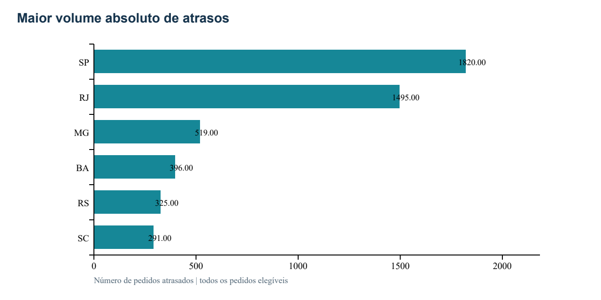
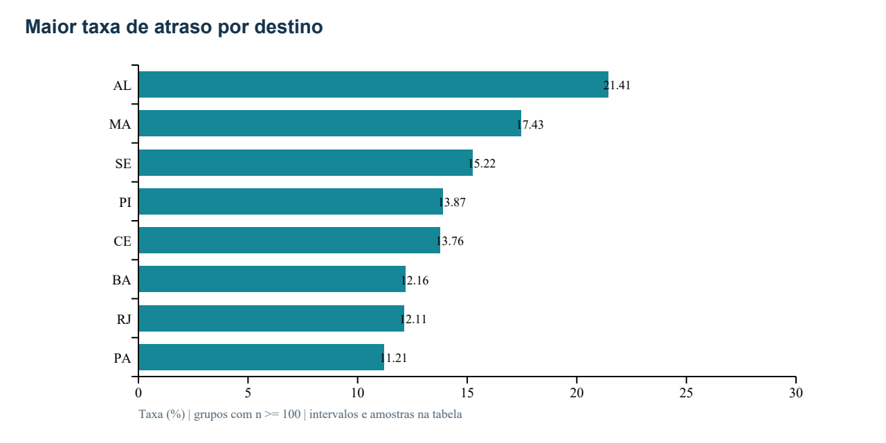
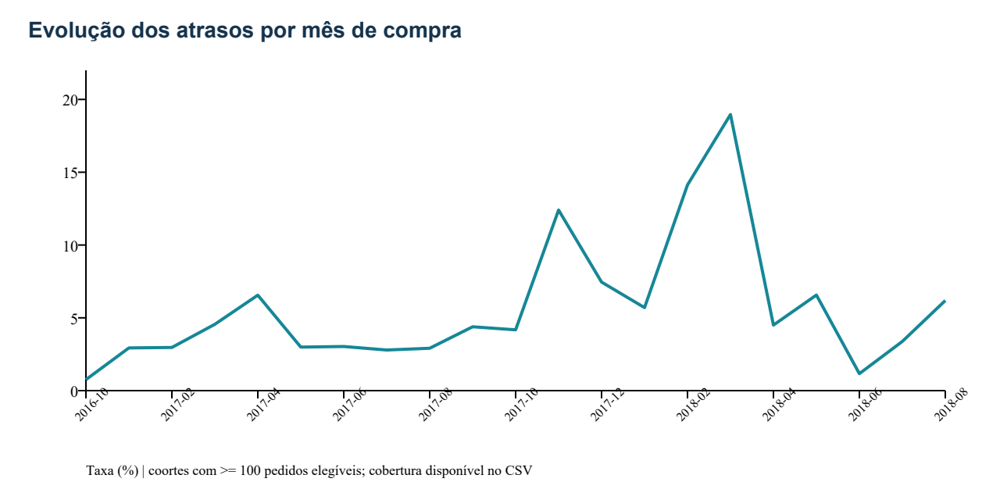
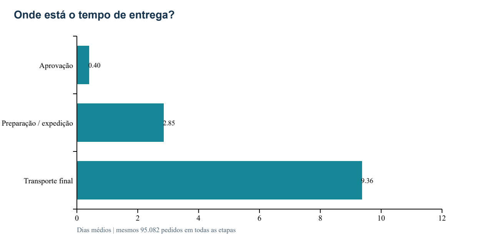
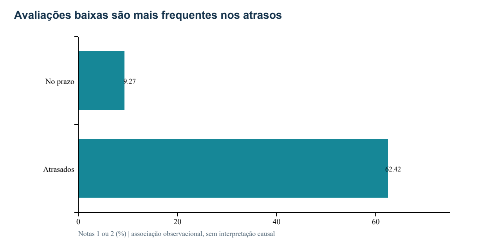

# PSP8 | Diagnóstico dos atrasos de entrega no comércio eletrônico

**Rafael Leivas Bisi · Universidade de Brasília · Engenharia de Produção · 21/10/2026**

## Resumo executivo

O MVP organiza dados históricos da Olist em um modelo estrela e produz indicadores para priorizar investigações logísticas. Dos **99.441 pedidos**, **96.470** permitem avaliar pontualidade: **6.534 atrasaram (6,77%)**. São Paulo e Rio de Janeiro somam **50,73% dos atrasos**, mas a taxa de RJ (12,11%) é muito superior à de SP (4,49%). A prioridade depende simultaneamente de volume e risco.

**Situação da execução:** cálculo local concluído e notebook executado pelo autor no Databricks Free Edition em 21/10/2026. As 11 células de código foram observadas com sucesso e os resultados das consultas às tabelas Delta coincidem com o processamento local. A exportação com saídas e as capturas devem acompanhar a pasta `evidencias` antes da entrega final. Este README é o documento principal; o PDF é complementar.

## 1. Objetivo e planejamento inicial

**Problema:** onde um gestor de operações deve concentrar a investigação de falhas no cumprimento do prazo prometido?

**Objetivo:** construir um pipeline reproduzível de coleta, qualidade, modelagem, persistência na nuvem e análise, fornecendo uma lista justificada de prioridades logísticas. Usuário-alvo: gestor de logística/operações de comércio eletrônico.

**Hipótese:** atrasos variam entre destinos e períodos e estão associados a maior frequência de avaliações baixas. O [planejamento original](docs/01_planejamento_inicial.md) foi registrado antes da coleta e análise. As cinco perguntas originais foram preservadas:

1. Qual a proporção de pedidos entregues após a data prometida e qual a magnitude desses atrasos?
2. Quais estados de destino concentram mais atrasos e quais têm maiores taxas, considerando o volume de pedidos?
3. Como a taxa de atraso e o tempo de entrega evoluem por mês de compra?
4. Como o prazo entre compra e entrega se distribui entre aprovação, preparação/entrega à transportadora e transporte final?
5. Qual a associação entre atraso e avaliação baixa do cliente (notas 1 ou 2)?

**Critério de aceitação:** cinco respostas reproduzíveis; dados persistidos e relidos em Delta; catálogo e regras de negócio explícitos. O MVP apoia uma decisão, mas não implementa nem mede uma intervenção operacional. Não houve entrevista ou teste com gestor: a desejabilidade permanece uma hipótese.

## 2. Busca e coleta

Escolheu-se a [base oficial da Olist no Kaggle](https://www.kaggle.com/datasets/olistbr/brazilian-ecommerce) porque contém compra, promessa, entrega, destino e avaliação, variáveis necessárias às perguntas. É um retrato histórico de pedidos de 2016 a 2018, não uma amostra probabilística do comércio eletrônico brasileiro. A coleta foi realizada em **21/10/2026** via endpoint público do próprio Kaggle, sem scraping de páginas ou uso de credenciais.

| Arquivo utilizado | Linhas | Finalidade |
|---|---:|---|
| olist_orders_dataset.csv | 99.441 | Datas, status e chave do pedido |
| olist_customers_dataset.csv | 99.441 | UF de destino e chave de junção |
| olist_order_reviews_dataset.csv | 99.224 | Nota, chave e cronologia das avaliações |

O ZIP oficial foi baixado integralmente; apenas três arquivos foram processados. Tamanho, hashes SHA-256 por arquivo, formato CSV e instantes de processamento constam no [manifesto de coleta](resultados/manifesto_coleta.json). Em execução com ZIP local, o manifesto distingue processamento de download e registra a data de modificação do arquivo como metadado auxiliar, sem tratá-la como prova universal da coleta.

## 3. Arquitetura e modelagem

**Tecnologias:** Python, pandas, NumPy, SQL, Spark e Delta Lake no Databricks Free Edition. O tratamento deste pequeno volume ocorre em pandas no driver; Spark grava e consulta tabelas, sem alegação de transformação distribuída.


O grão da fato é **um pedido**, preservado após cada junção. O modelo estrela possui dimensões de data, destino e status. Os [diagramas, chaves e catálogo](catalogo/README.md) descrevem todos os atributos bronze/silver e as métricas Gold; o [CSV do catálogo](catalogo/catalogo.csv) registra tipos, domínios esperados, nulabilidade, linhagem e extremos observados.

## 4. Transformação e carga

1. Ler os CSV como texto, preservando IDs. Auditar os **20 atributos originais** antes de descartar campos.
2. Projetar somente campos necessários: não persistir comentários livres, CEP, cidade ou identificador de cliente recorrente.
3. Converter datas com erro explícito em nulo. Verificar chaves de pedidos/clientes; uma PK duplicada interrompe a execução.
4. Consolidar avaliações por pedido: última resposta, depois data de criação, ID e nota como desempates determinísticos. Valores nulos de ordenação vêm primeiro. Há **551 registros de avaliação excedentes por pedido**, não necessariamente erros.
5. Juntar pedidos e clientes com validação muitos-para-um; juntar a avaliação consolidada com validação um-para-um. Não houve cliente sem correspondência. A fato preserva **99.441 linhas e IDs distintos**.
6. Pontualidade: incluir somente status `delivered`, com compra/entrega/promessa válidas, entrega não anterior à compra e promessa não anterior ao dia da compra. Entrega no mesmo dia civil da promessa é pontual, mesmo após 00h00.
7. Calcular durações em segundos / 86.400. Atraso em dias usa datas civis. Os timestamps não possuem fuso declarado na origem; não há conversão presumida de fuso.
8. Para etapas, exigir sequência completa e não decrescente. Não imputar eventos ou notas. Pedidos inelegíveis permanecem na fato, com flags e medidas nulas.
9. Gravar **13 tabelas Delta** (3 bronze, 4 silver, 5 gold e 1 auditoria), em `workspace.psp8_logistica`, usando substituição apenas nas tabelas do projeto. Relê-las e comparar as contagens, PKs, FKs e soma dos atrasos em SQL.

A reexecução substitui a fotografia atual; hashes permitem identificar mudanças na origem. Não é carga incremental: uso contínuo exigiria controle de versões, monitoramento, estratégia de atualização e tratamento de mudanças no esquema. O notebook grava manifesto e verificações em `/Volumes/workspace/psp8_logistica/arquivos/resultados`.

## 5. Qualidade dos dados

O [perfil por atributo](resultados/qualidade_atributos.csv) cobre todos os campos dos três arquivos de origem. Foram verificadas completude, unicidade, domínio, consistência temporal e correspondência de chaves. A acurácia factual não pode ser comprovada sem registros externos; verificações de plausibilidade não equivalem à confirmação dos eventos.

| Achado | Resultado | Tratamento / impacto |
|---|---:|---|
| Aprovação ausente | 160 | Preservar; pode impedir decomposição de etapas |
| Expedição ausente | 1.783 | Preservar; não imputar transporte |
| Entrega ausente | 2.965 | Não classificar automaticamente como pontual |
| Pedidos inelegíveis à pontualidade | 2.971 | Manter na fato; excluir apenas do denominador de pontualidade |
| Entregues, mas inelegíveis | 8 | Datas ausentes/inconsistentes |
| Elegíveis sem sequência válida de etapas | 1.388 | Excluir apenas da análise de etapas |
| Pedidos sem nota após junção | 768 | Excluir apenas da análise de avaliação |
| Notas fora de 1–5, IDs fora do formato e UF inválida | 0 | Evidência de conformidade, não de ausência de todo problema |
| Título / comentário ausentes | 88,34% / 58,70% | Campos não usados; não persistidos na nuvem |

Ausência pode ser estrutural em pedidos cancelados ou ainda em trânsito. `review_id` não é uma PK global confiável; o pipeline resolve a unidade por `order_id`. O conjunto é antigo: atualidade inadequada para decisão corrente sem atualização. Textos livres têm domínio aberto e não foram submetidos a validação semântica.

## 6. Resultados e discussão

### Q1. Frequência e magnitude

**6,77%** dos **96.470 pedidos elegíveis** atrasaram (6.534 pedidos; IC 95% de Wilson: **6,62% a 6,93%**). Entre os atrasados, a mediana é **7 dias** e o percentil 90, **22 dias**. Entre todos os elegíveis, o prazo total mediano é **10,22 dias** e o P90, **23,10 dias**.

O atraso não é apenas uma ocorrência binária: a cauda de atrasos longos justifica monitorar severidade e comunicação ao cliente. Esses valores não incluem cancelamentos nem pedidos sem entrega observada. [Resumo reproduzível](resultados/resumo.json) · [status e denominadores](resultados/por_status.csv).

### Q2. Destinos prioritários

| UF | Elegíveis | Atrasos | Taxa | IC 95% |
|---|---|---|---|---|
| SP | 40.494 | 1.820 | 4,49% | 4,30% a 4,70% |
| RJ | 12.350 | 1.495 | 12,11% | 11,54% a 12,69% |
| MG | 11.354 | 519 | 4,57% | 4,20% a 4,97% |
| BA | 3.256 | 396 | 12,16% | 11,08% a 13,33% |
| RS | 5.344 | 325 | 6,08% | 5,47% a 6,75% |
| SC | 3.546 | 291 | 8,21% | 7,35% a 9,16% |




RJ combina **1.495 atrasos** e taxa de **12,11%**; é prioridade de investigação por volume e risco. SP tem **1.820 atrasos**, mas taxa de **4,49%**, abaixo da média: seu volume comercial explica parte da concentração. Os dois estados concentram **50,73%** dos atrasos.

| UF | Elegíveis | Taxa | IC 95% |
|---|---|---|---|
| AL | 397 | 21,41% | 17,66% a 25,71% |
| MA | 717 | 17,43% | 14,83% a 20,38% |
| SE | 335 | 15,22% | 11,77% a 19,46% |
| PI | 476 | 13,87% | 11,05% a 17,26% |
| CE | 1.279 | 13,76% | 11,98% a 15,76% |




AL tem a maior taxa entre UFs com pelo menos 100 pedidos, mas amostra menor e intervalo mais amplo. O limite de 100 foi pré-definido para apresentação e não prova precisão nem representatividade. Comparações são exploratórias, sem correção por múltiplas comparações; não se atribui culpa a transportadoras, que não foram identificadas. [Tabela completa](resultados/por_uf.csv).

### Q3. Evolução mensal



Março/2018 tem taxa de **18,96%** (1.328/7.003), fevereiro/2018 **14,13%** e novembro/2017 **12,40%**. A série identifica períodos de atenção, mas dois anos incompletos não sustentam uma conclusão robusta de sazonalidade. Não se atribui o pico a greve, evento promocional ou outra causa sem investigação adicional.

A [tabela mensal](resultados/por_mes.csv) inclui total, elegíveis, cobertura, mediana e P90. Meses com poucos pedidos não aparecem no gráfico. Coortes sem entrega elegível devem ser interpretadas como sem estimativa, nunca taxa zero. Mudanças de mix e cobertura condicionam comparações; menor atraso não prova melhoria operacional.

### Q4. Decomposição do prazo

| Etapa | Média (dias) | Mediana | P90 |
|---|---|---|---|
| Aprovação | 0,40 | 0,01 | 1,39 |
| Preparação/expedição | 2,85 | 1,85 | 6,02 |
| Transporte | 9,36 | 7,11 | 18,95 |
| Total | 12,62 | 10,27 | 23,16 |




Os **95.082 pedidos** com sequência completa mostram que transporte final ocupa **74,21% do prazo médio total**. É uma frente de investigação, mas tempo longo não equivale automaticamente a desperdício: distância e nível de serviço podem explicá-lo. O intervalo aprovação–expedição é uma aproximação operacional, não um cronômetro exclusivo de produção ou separação. As médias das etapas somam a média total porque usam os mesmos pedidos; as medianas e P90 não são aditivos. [Dados](resultados/etapas.csv).

### Q5. Atraso e avaliação baixa

| Grupo | Com avaliação | Notas 1–2 | Proporção baixa |
|---|---|---|---|
| No prazo | 89.443 | 8.289 | 9,27% |
| Atrasados | 6.381 | 3.983 | 62,42% |




A diferença é **53,15 pontos percentuais**, com IC 95% de Newcombe de **51,94 a 54,35 p.p.** A cobertura de avaliações entre elegíveis é **99,33%**. O resultado sustenta associação descritiva forte, mas não permite afirmar que eliminar atrasos causaria essa melhora: qualidade do produto, vendedor, destino, época, seleção de respondentes e momento da avaliação podem interferir. A última avaliação foi escolhida antes de observar o resultado. [Tabela](resultados/avaliacoes.csv).

### Métodos e limites estatísticos

Taxas são proporções de pedidos; Wilson usa z=1,959964 e evita intervalos simétricos inadequados perto de 0 ou 1. Newcombe combina os limites de Wilson dos dois grupos para a diferença de proporções. As fórmulas estão em `wilson` e `analyze`. Quantis seguem interpolação linear do pandas. Os intervalos supõem aproximação binomial/independência; pedidos de clientes, vendedores e períodos comuns podem ser dependentes. Não corrigem viés de seleção nem tornam a base representativa. Como se analisa toda a fotografia disponível, os percentuais observados são exatos para ela; os intervalos apenas ilustram incerteza sob um modelo de repetição hipotética.

## 7. Síntese gerencial e validação do MVP

1. Investigar RJ por combinar volume e taxa; manter frente de volume em SP e triagem de alto risco em AL/MA, sem ignorar a incerteza.
2. Examinar capacidade e promessas nos meses críticos; solicitar dados de transportadora, distância e eventos operacionais para testar explicações.
3. Monitorar tempo de transporte e severidade do atraso; associar ação de comunicação ao cliente a uma avaliação futura controlada.

A hipótese inicial é **compatível com as diferenças descritivas observadas**; não foi feito teste global de heterogeneidade ou experimento causal. Viabilidade técnica foi demonstrada pela execução no Databricks. Viabilidade financeira: uso da edição gratuita dentro de suas cotas, sem infraestrutura paga contratada para o MVP; custo de produção, horas de trabalho e manutenção não foram estimados monetariamente. Desejabilidade: proposta plausível de apoio ao gestor, ainda sem validação com usuário real.

## 8. Autoavaliação

As cinco perguntas foram respondidas no recorte observado, com ressalvas de cobertura e temporalidade. O objetivo de diagnóstico foi atingido; causas e efeito de intervenções permanecem fora do alcance. Dificuldades concretas foram o cadastro/acesso às plataformas, a restrição à automação do console e a necessidade de executar/importar manualmente, além de conciliar múltiplas avaliações e datas incompletas.

Ao recomeçar, seria desejável incluir desde o início dados de rotas/transportadoras, calendário operacional e entrevista com um gestor, além de modelar a dependência entre pedidos e a seleção de entregas. Para uso contínuo: ingestão incremental, testes automatizados de contrato e domínio, alertas de qualidade, monitoramento de custos, controle de acesso, métricas de processo e experimento para medir benefício real. A autoavaliação deve ser revisada pelo autor para refletir seu aprendizado pessoal antes da submissão.

## 9. Reprodução e entrega

### Databricks

Importe [01_pipeline_databricks.ipynb](notebooks/01_pipeline_databricks.ipynb), selecione Serverless e execute Run all. O catálogo padrão é `workspace`; ajuste-o se sua conta usar outro nome. Se o Kaggle estiver bloqueado pela rede, envie o ZIP oficial ao volume criado pela primeira célula e configure `SOURCE_ZIP`. O notebook grava tabelas em `workspace.psp8_logistica`, valida contagens e consulta os resultados persistidos. Não é necessário fornecer senha ou token ao código.

### Local

```bash
python -m pip install -r requirements.txt
python scripts/pipeline.py --out resultados
python scripts/test_pipeline.py
```

Também é possível usar `--zip caminho/olist.zip`. Os testes verificam entrega no dia prometido, dados ausentes, avaliação múltipla sem duplicação, soma das durações e limites dos intervalos. A execução local não cria tabelas Delta nem substitui a evidência da nuvem.

```text
README.md                 documento principal
notebooks/                execução completa na nuvem
scripts/                  pipeline e testes de regras
catalogo/                 modelo, linhagem e catálogo
resultados/               métricas, qualidade e gráficos
evidencias/               exportação/capturas da execução real
docs/                     planejamento inicial e instruções
```

### Evidências

O [registro de evidências](evidencias/README.md) distingue observação da execução e arquivos exportados. Incluir capturas legíveis da persistência, das tabelas no Catalog e das respostas. O endereço privado do Databricks não substitui evidências acessíveis ao professor. A entrega no fórum deve usar o link público deste repositório.

## 10. Fontes, licenças e transparência

- Olist. [Brazilian E-Commerce Public Dataset](https://www.kaggle.com/datasets/olistbr/brazilian-ecommerce). Consulta/coleta: 21/10/2026. Licença [CC BY-NC-SA 4.0](https://creativecommons.org/licenses/by-nc-sa/4.0/). Uso acadêmico, atribuição e compartilhamento das adaptações sob a mesma licença; uso comercial não autorizado por esta licença.
- Wilson, E. B. (1927). [Probable Inference, the Law of Succession, and Statistical Inference](https://doi.org/10.1080/01621459.1927.10502953). JASA, 22, 209–212.
- Newcombe, R. G. (1998). [Interval estimation for the difference between independent proportions](https://pubmed.ncbi.nlm.nih.gov/9595617/). Statistics in Medicine, 17, 873–890.
- Databricks. [Free Edition](https://docs.databricks.com/aws/en/getting-started/free-edition) e [importação de notebooks](https://docs.databricks.com/aws/en/notebooks/notebook-export-import). Consulta: 21/10/2026.

Não se republicam os CSV brutos neste repositório. Resultados agregados e adaptações dos dados seguem CC BY-NC-SA 4.0; código segue MIT (ver LICENSE). IDs são pseudônimos, não prova de anonimização completa. Uso de IA: houve assistência de Codex no planejamento técnico, programação, documentação e revisão. Cabe ao autor compreender, conferir e adequar a declaração às regras da disciplina.
