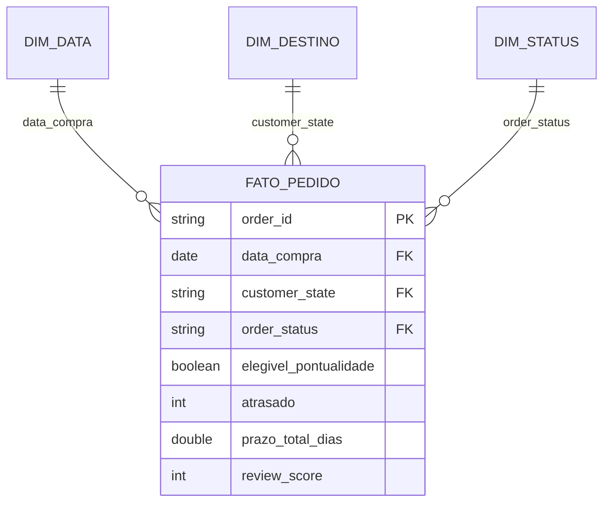
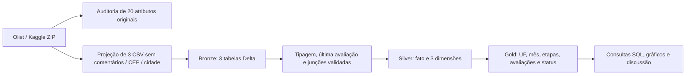

# Modelo e catálogo

O [catálogo completo](catalogo.csv) contém todos os atributos das tabelas bronze e silver, tipos, descrição, domínios, nulabilidade, linhagem, mínimos/máximos observados e contagens de nulos. A extração e os hashes estão no [manifesto](../resultados/manifesto_coleta.json). Domínios esperados são regras; extremos observados são diagnósticos da versão atual.

## Grão e chaves

- `silver_fato_pedido`: uma linha por pedido, PK `order_id`; 99.441 linhas, incluindo inelegíveis sinalizados.
- `silver_dim_data`: uma linha por data civil; PK `data_compra`; inclui dias sem pedidos no intervalo.
- `silver_dim_destino`: uma linha por UF e uma linha ND; PK `customer_state`.
- `silver_dim_status`: uma linha por status; PK `order_status`.
- FKs da fato: `data_compra`, `customer_state`, `order_status`. As datas detalhadas são mantidas na fato para calcular durações.
- Modelo estrela simples, com chaves naturais estáveis no recorte histórico. `mes_compra` é uma conveniência derivada para agregação.

## Linhagem

No código, bronze e silver são construídas em memória antes da gravação; a origem lógica da silver são as projeções bronze. Não se alega uma leitura física intermediária de bronze durante essa execução. O notebook grava e relê todas as tabelas para verificar a persistência.

## Catálogo das agregações Gold

`gold_por_uf` tem uma linha por UF; `gold_por_mes`, uma por coorte de compra; `gold_por_status`, uma por status; `gold_etapas`, uma por etapa; `gold_avaliacoes`, uma por grupo de atraso.

| Atributo | Significado e domínio |
|---|---|
| pedidos / total / elegiveis / atrasos | Contagens inteiras entre 0 e 99.441; atrasos <= pedidos |
| taxa_atraso | atrasos / pedidos, de 0 a 1; nulo se denominador zero |
| ic95_inferior / ic95_superior | Limites de Wilson para a proporção do grupo, entre 0 e 1 |
| prazo_mediano_dias / prazo_p90_dias | Quantis do prazo_total_dias no grupo, >= 0 |
| cobertura | elegiveis / total, de 0 a 1 |
| etapa | aprovacao_dias, preparacao_dias, transporte_dias ou prazo_total_dias |
| n | Número de sequências completas, inteiro >= 0 |
| media_dias / mediana_dias / p90_dias | Estatísticas da etapa, >= 0 |
| pedidos_com_avaliacao / avaliacoes_baixas | Inteiros >= 0; baixas <= avaliados |
| proporcao_baixa | avaliações baixas / avaliados, de 0 a 1 |
| nota_media | Média das notas, de 1 a 5 |

Gold é derivada de `silver_fato_pedido` por `analyze`. Chaves de agrupamento seguem os domínios da silver. Campos de contagem são obrigatórios; medidas de grupos vazios podem ser nulas. `auditoria_qualidade` documenta uma linha por atributo da origem e não contém valores pessoais ou comentários livres.
