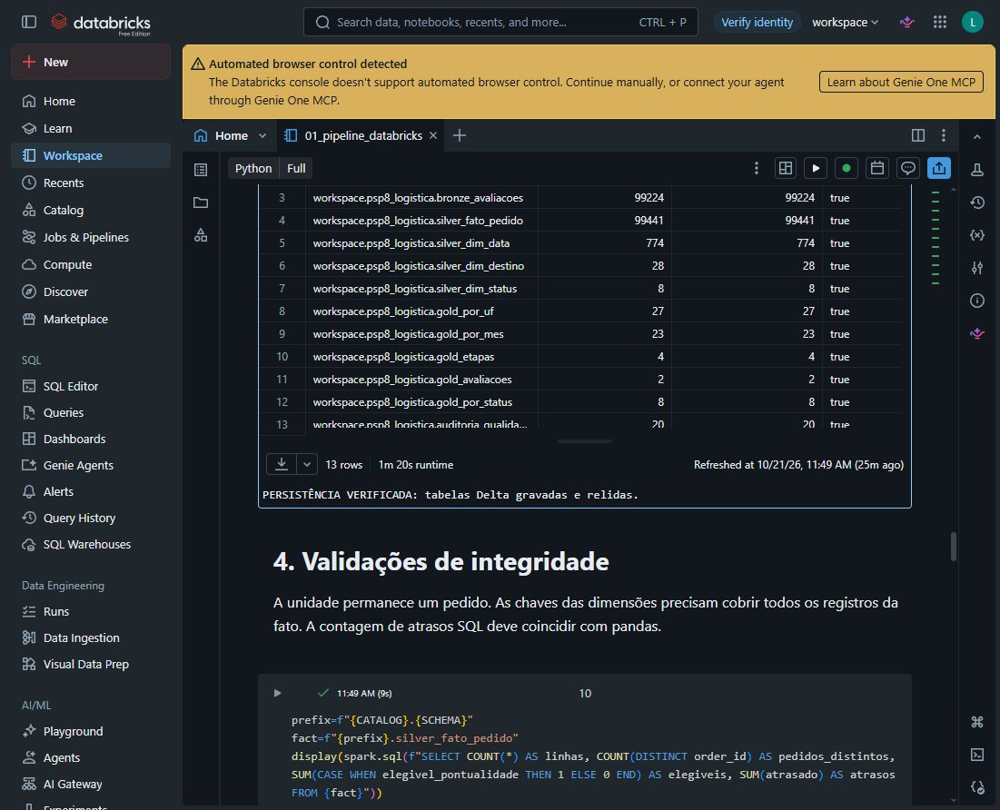
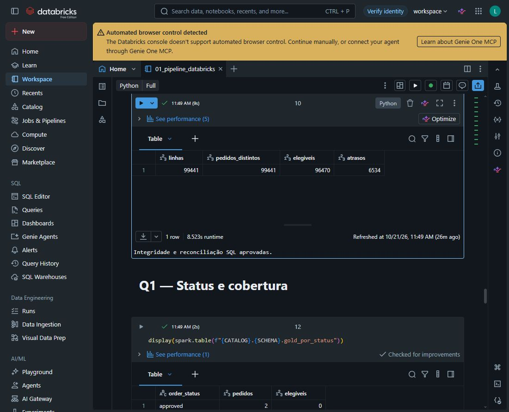
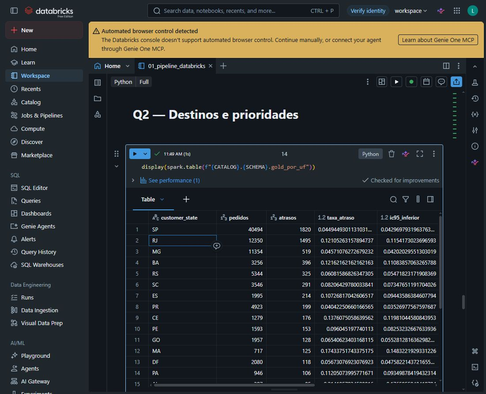
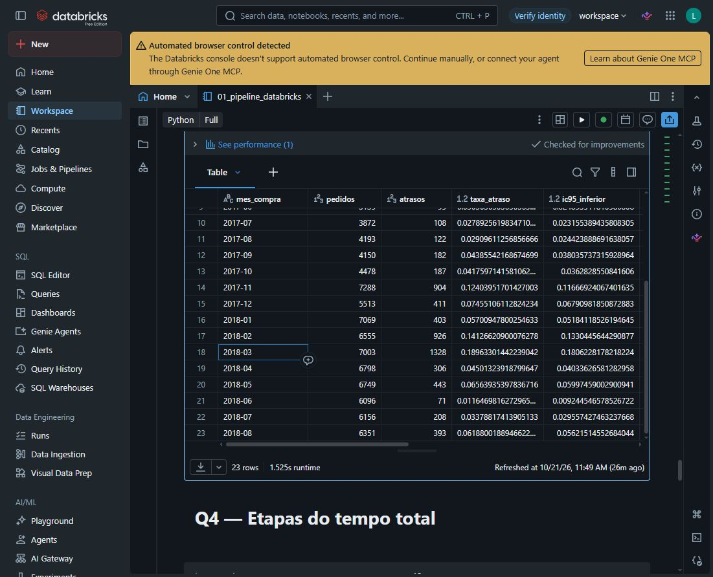
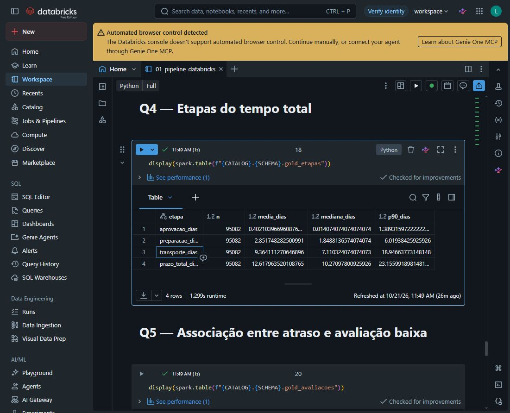
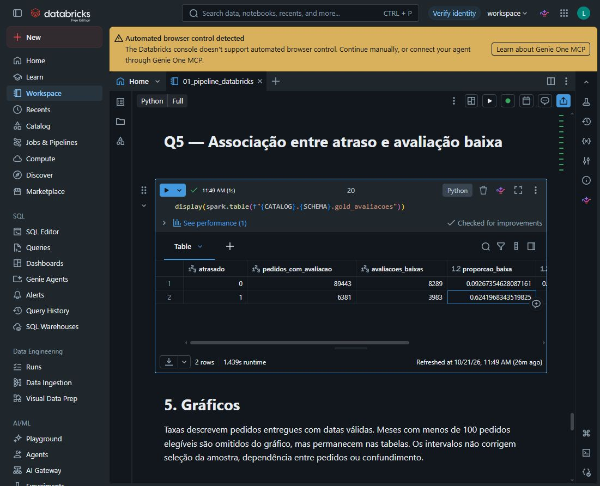

# Evidências reais do Databricks

Execução em 21/10/2026, às 11h49 (Brasília), no Databricks Free Edition. As capturas abaixo foram obtidas diretamente da interface, sem alterar valores ou produzir saídas sintéticas. O notebook foi importado e executado pelo autor.

## Persistência e integridade

13 tabelas Delta foram gravadas e relidas, com todas as contagens iguais às origens. A fato contém 99.441 pedidos distintos; 96.470 são elegíveis e 6.534 atrasaram. As chaves estrangeiras foram conferidas.

## Respostas às perguntas

Q2 — destinos:

Q3 — evolução mensal:

Q4 — decomposição do prazo:

Q5 — avaliação baixa:

O arquivo [registro_execucao_observada.txt](registro_execucao_observada.txt) contém texto das células de coleta, persistência e integridade lido da interface. Inclui o manifesto da coleta em nuvem e a reconciliação das 13 tabelas. Trata-se de registro de observação, não exportação oficial do notebook. O download oficial pelo menu não iniciou durante a interação automatizada.

O notebook em notebooks/ está sem saídas para reprodução. Os resultados e as evidências desta pasta documentam a execução efetivamente observada. As imagens mantêm o contexto da plataforma e não exibem credenciais.
